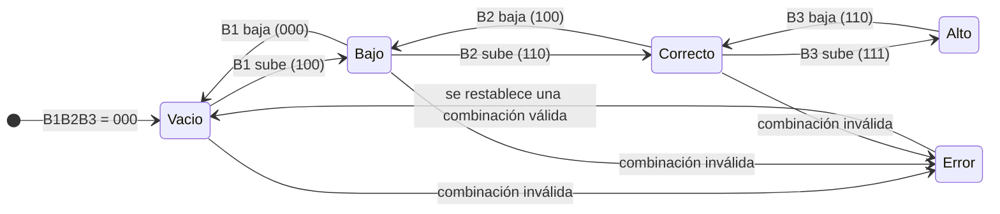
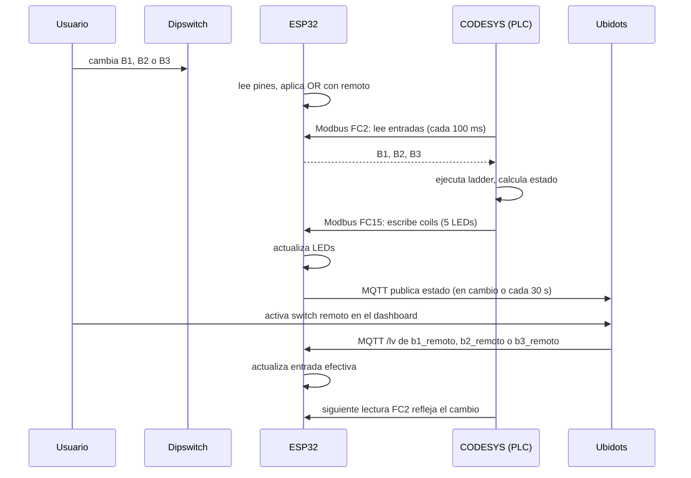

# Diseño del Sistema

## Requisitos y restricciones

- El estado del tanque se determina con tres sensores binarios: B1 (vacío), B2 (normal) y B3 (desbordamiento).
- El sistema debe indicar cinco estados: Vacío, Bajo, Correcto, Alto y Error.
- La lógica de control se mantiene en el PLC virtual (CODESYS). El ESP32 solo hace de interfaz de campo y de pasarela a la nube.
- El estado debe poder consultarse y modificarse desde Ubidots sin romper el funcionamiento local.
- Restricciones: red WiFi de un hotspot móvil, plan gratuito de Ubidots (STEM), runtime CODESYS en modo demostración.

## Lógica del tanque

Extraída del ladder implementado (`Ejercicio_Tanque.xml`). Las combinaciones no listadas como estado normal se consideran error.

| B1 | B2 | B3 | Estado | LED |
|---|---|---|---|---|
| 0 | 0 | 0 | Vacío | GPIO 18 |
| 1 | 0 | 0 | Bajo | GPIO 19 |
| 1 | 1 | 0 | Correcto | GPIO 21 |
| 1 | 1 | 1 | Alto | GPIO 22 |
| 0 | 0 | 1 | Error | GPIO 23 |
| 0 | 1 | 0 | Error | GPIO 23 |
| 0 | 1 | 1 | Error | GPIO 23 |
| 1 | 0 | 1 | Error | GPIO 23 |

Ecuaciones booleanas:

- Alto = B1 · B2 · B3
- Correcto = B1 · B2 · ¬B3
- Bajo = B1 · ¬B2 · ¬B3
- Vacío = ¬B1 · ¬B2 · ¬B3
- Error = (¬B2 · B3) + (¬B1 · B2)

Las ocho combinaciones quedan cubiertas y los estados son mutuamente excluyentes.

## Arquitectura

El diagrama de arquitectura del sistema se presenta en la sección "Vista general" de la página [Home](Home). Sus bloques son el activo físico (dipswitch y LEDs), el ESP32 (servidor Modbus TCP y cliente MQTT), el activo virtual en el PC (CODESYS y HMI) y la plataforma IoT (Ubidots).

Decisiones de diseño:

1. **La lógica vive en CODESYS.** El ESP32 no calcula los estados. Esto mantiene el gemelo digital como la fuente de verdad del proceso y deja al ESP32 como interfaz intercambiable.
2. **El ESP32 es el servidor Modbus.** CODESYS inicia las conexiones y consulta cíclicamente cada 100 ms.
3. **Variables de estado y de comando separadas en Ubidots.** `b1`, `b2`, `b3` son estado (el ESP32 escribe, Ubidots muestra). `b1_remoto`, `b2_remoto`, `b3_remoto` son comandos (Ubidots escribe, el ESP32 lee). Si se usaran las mismas variables, el ESP32 recibiría su propia publicación como si fuera un comando y se enclavaría el valor.
4. **Combinación OR entre dip y comando remoto.** La entrada efectiva es `dip OR remoto`. Es la opción más simple y no requiere un selector Local/Remoto. Su limitación: un dip en ON no se puede apagar desde Ubidots.

## Mapa de registros Modbus

El ESP32 expone el siguiente mapa (el mapeo en CODESYS usa las mismas direcciones):

| Tipo | Dirección | Función | Variable CODESYS | Pin ESP32 | Sentido |
|---|---|---|---|---|---|
| Discrete input | 0 | FC2 | B1 | GPIO 4 | Entrada |
| Discrete input | 1 | FC2 | B2 | GPIO 16 | Entrada |
| Discrete input | 2 | FC2 | B3 | GPIO 17 | Entrada |
| Coil | 0 | FC15 | Vacio | GPIO 18 | Salida |
| Coil | 1 | FC15 | Bajo | GPIO 19 | Salida |
| Coil | 2 | FC15 | Correcto | GPIO 21 | Salida |
| Coil | 3 | FC15 | Alto | GPIO 22 | Salida |
| Coil | 4 | FC15 | Error | GPIO 23 | Salida |

## Diagrama UML de secuencia

## Viabilidad económica

El prototipo usa componentes de bajo costo. El software utilizado no tiene costo en el alcance académico: CODESYS (entorno y runtime en modo demostración), Arduino IDE, bibliotecas de código abierto y Ubidots STEM.

| Componente | Cantidad | Costo unitario (COP) | Subtotal (COP) |
|---|---|---|---|
| ESP32 DevKit | 1 | _completar_ | _completar_ |
| Dipswitch de 3 posiciones o más | 1 | _completar_ | _completar_ |
| LEDs | 5 | _completar_ | _completar_ |
| Resistencias 220 o 330 Ω | 5 | _completar_ | _completar_ |
| Protoboard y cables | 1 | _completar_ | _completar_ |
| **Total del prototipo** | | | _completar_ |

Para una solución real (sensores de nivel industriales, PLC físico y red cableada) el costo cambia de orden de magnitud. Esa estimación queda fuera del alcance de este prototipo.

---

Anterior: [Resumen](Resumen) | Siguiente: [Implementación en CODESYS](Implementacion-en-CODESYS)
