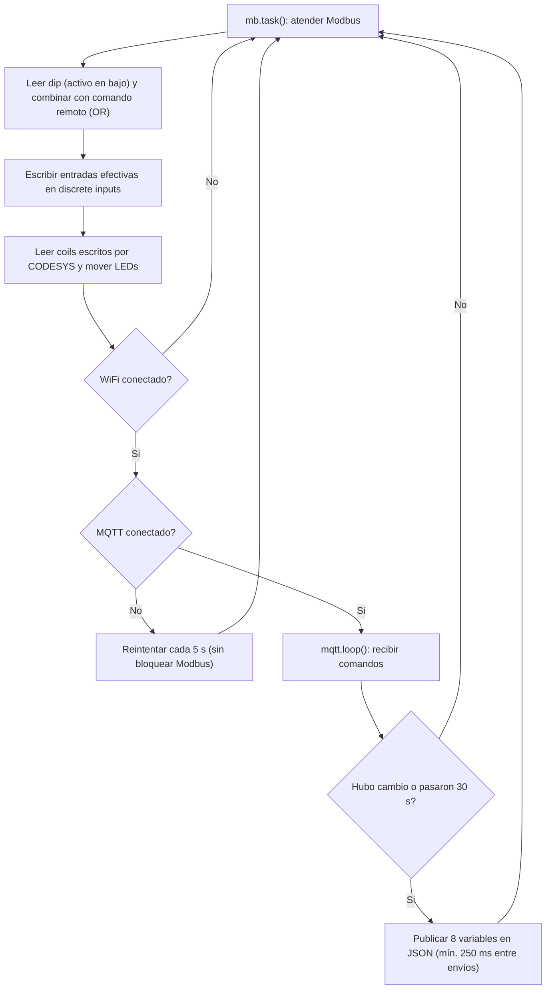

# Hardware Real

## Esquema de interconexión

El dipswitch es activo en bajo: cada pin usa `INPUT_PULLUP` y el interruptor en ON lleva el pin a GND. El firmware invierte la lectura para que ON signifique verdadero.

| Elemento | Conexión |
|---|---|
| Dip B1, B2, B3 | Un terminal a GPIO 4, 16, 17; el otro a GND |
| LED Vacío, Bajo, Correcto, Alto, Error | Ánodo a GPIO 18, 19, 21, 22, 23 mediante resistencia (220 o 330 Ω); cátodo a GND |

> **Pendiente del autor:** insertar aquí la foto del montaje y el esquemático (por ejemplo, exportado de Fritzing). Imagen sugerida: ``.

## Firmware del ESP32

El firmware (`conexion_modbus/conexion_modbus.ino`) usa las bibliotecas `modbus-esp8266` (servidor Modbus TCP) y `PubSubClient` (MQTT). Su funcionamiento en cada ciclo de `loop()`:

Aspectos relevantes:

- Reconexión MQTT sin bloqueo, para no interrumpir el servicio Modbus.
- Publicación por cambio, con latido cada 30 s y separación mínima de 250 ms, para respetar los límites del plan gratuito.
- `WiFi.setSleep(false)` para mantener estable el enlace TCP.

---

Anterior: [Implementación en CODESYS](Implementacion-en-CODESYS) | Siguiente: [Comunicación Modbus](Comunicacion-Modbus)
