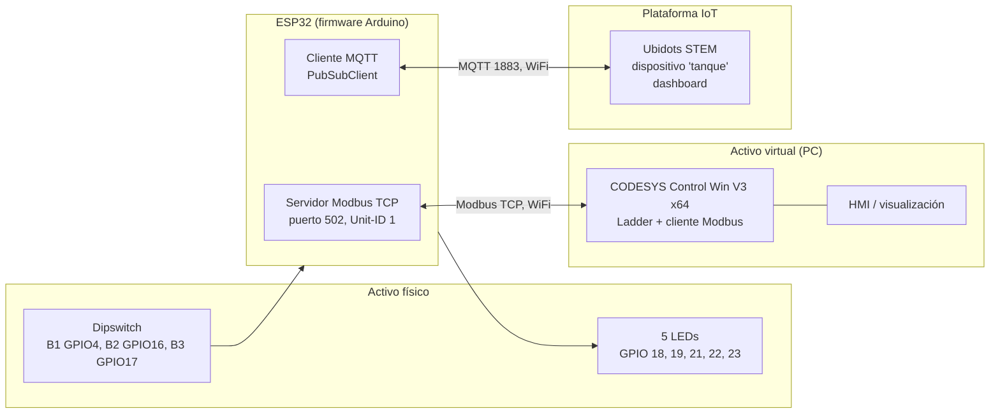

# Gemelo Digital de un Tanque con CODESYS, ESP32, Modbus TCP y Ubidots

Curso: Internet Industrial de las Cosas (IIoT) y Nuevas Tendencias, Universidad de La Sabana.
Resultado de aprendizaje: RA 3.2. Sustentación: 3 de noviembre de 2026.

Esta wiki documenta el diseño, la implementación y la validación de un gemelo digital de un sistema de monitoreo de nivel de un tanque. El activo físico (dipswitch y LEDs sobre un ESP32) se conecta por Modbus TCP con un activo virtual en CODESYS, y el estado se publica en la plataforma IoT Ubidots por MQTT.

## Contenido

| Página | Temas |
|---|---|
| [Resumen](Resumen) | Síntesis del proyecto y requisitos del reto frente a su cumplimiento |
| [Diseño del Sistema](Diseno-del-Sistema) | Requisitos, lógica del tanque, arquitectura, decisiones de diseño, mapa de registros Modbus, diagrama UML de secuencia, viabilidad económica |
| [Implementación en CODESYS](Implementacion-en-CODESYS) | Activo virtual: programa Ladder, dispositivos y canales Modbus, I/O Mapping |
| [Hardware Real](Hardware-Real) | Esquema de interconexión y firmware del ESP32 |
| [Comunicación Modbus](Comunicacion-Modbus) | Enlace Modbus TCP entre CODESYS y el ESP32 |
| [Integración con Ubidots](Integracion-con-Ubidots) | Broker MQTT, publicación, comandos y dashboard |
| [Pruebas y Validación](Pruebas-y-Validacion) | Pruebas funcionales y de la plataforma IoT |
| [Problemas y Soluciones](Problemas-y-Soluciones) | Problemas encontrados durante el desarrollo y su resolución |
| [Conclusiones](Conclusiones) | Conclusiones, limitaciones y mejoras futuras |
| [Referencias](Referencias) | Referencias en formato IEEE |

## Vista general

Siguiente: [Resumen](Resumen)
