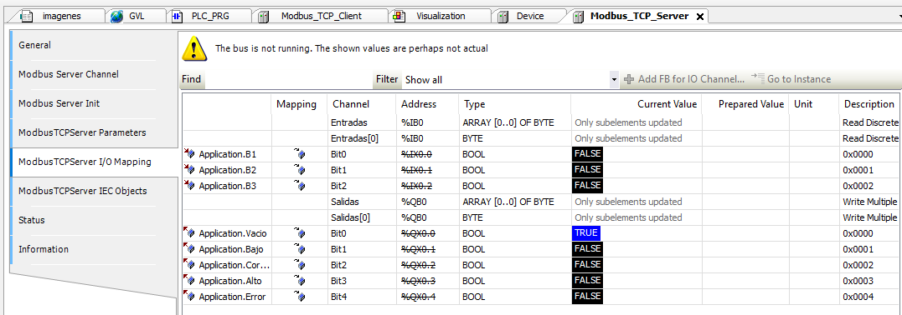
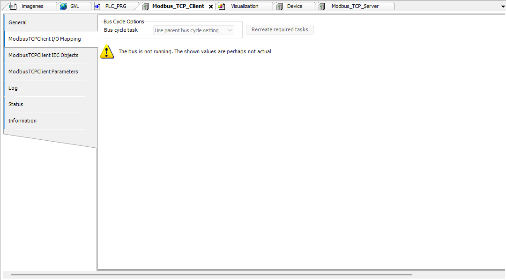

# Implementación en CODESYS

## Activo virtual en CODESYS

- Proyecto `Ejercicio_Tanque` con variables globales `B1`, `B2`, `B3` (entradas) y `Vacio`, `Bajo`, `Correcto`, `Alto`, `Error` (salidas), y un programa `PLC_PRG` en Ladder con cinco redes que implementan las ecuaciones de la lógica del tanque descritas en [Diseño del Sistema](Diseno-del-Sistema).
- Dispositivos Modbus: bajo el adaptador Ethernet se agregó un **Modbus TCP Client** y, como hijo suyo, un **Modbus TCP Server** (genérico) con IP del ESP32, puerto 502 y Unit-ID 1.
- Canales: `Entradas` (Read Discrete Inputs, FC2, cíclico 100 ms, offset 0, longitud 3) y `Salidas` (Write Multiple Coils, FC15, cíclico 100 ms, offset 0, longitud 5).
- I/O Mapping: cada bit se asignó a su variable global correspondiente.

> **Pendiente del autor:** insertar captura de la HMI de CODESYS en ejecución (``).

---

Anterior: [Diseño del Sistema](Diseno-del-Sistema) | Siguiente: [Hardware Real](Hardware-Real)
