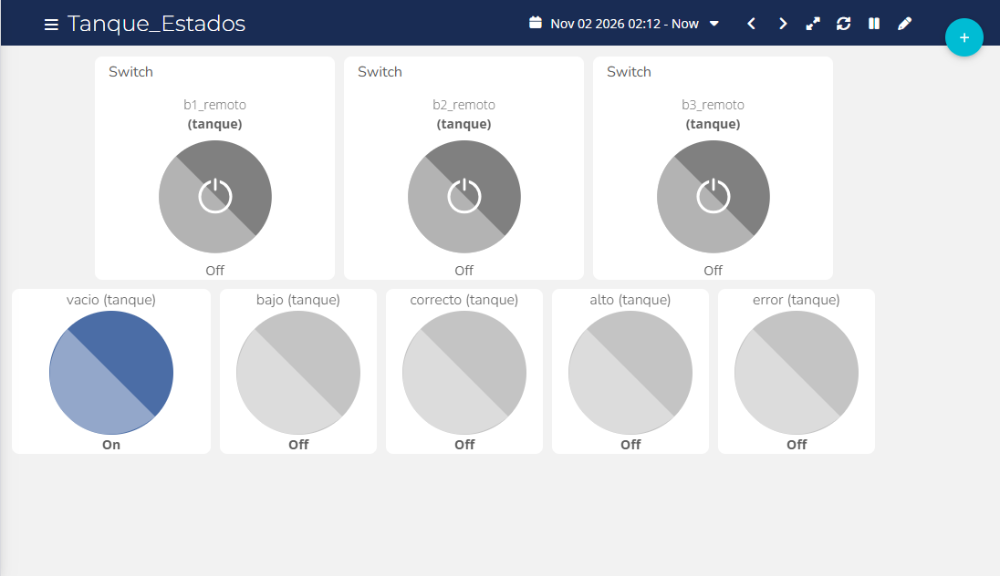
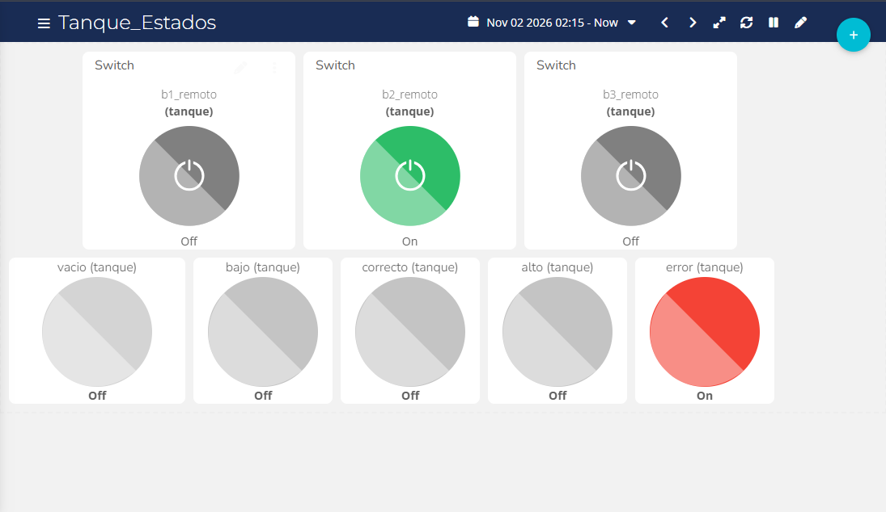
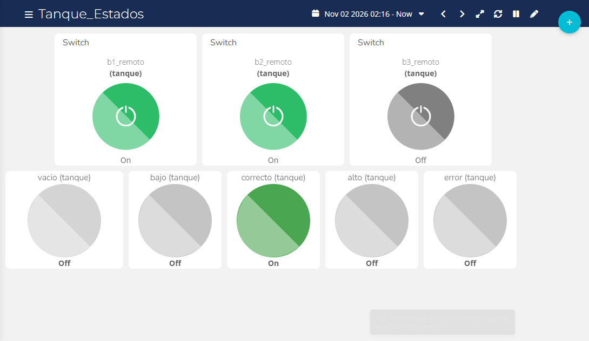

# Integración con Ubidots

## Plataforma IoT: Ubidots

- Broker: `industrial.api.ubidots.com`, puerto 1883, usuario igual al token de la cuenta y contraseña vacía [3], [4].
- **Publicación:** `/v1.6/devices/tanque` con un JSON de ocho variables: `b1`, `b2`, `b3`, `vacio`, `bajo`, `correcto`, `alto`, `error`.
- **Comandos:** el ESP32 se suscribe a `/v1.6/devices/tanque/<variable>/lv` para `b1_remoto`, `b2_remoto` y `b3_remoto`.
- **Dashboard:** indicadores para los cinco estados y tres switches de control ligados a las variables `_remoto`.

El dashboard `Tanque_Estados` muestra en la fila superior los tres switches de comando y en la inferior los cinco indicadores de estado. Capturas del dashboard en tres situaciones:

Todos los comandos remotos apagados: el indicador `vacio` está en On.

Con `b2_remoto` activo (combinación 010): el indicador `error` está en On.

Con `b1_remoto` y `b2_remoto` activos (combinación 110): el indicador `correcto` está en On.

Las referencias [3] y [4] se detallan en [Referencias](Referencias).

---

Anterior: [Comunicación Modbus](Comunicacion-Modbus) | Siguiente: [Pruebas y Validación](Pruebas-y-Validacion)
